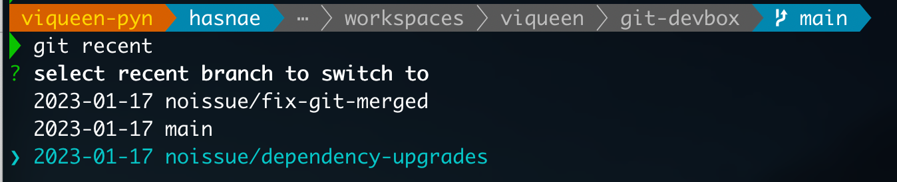
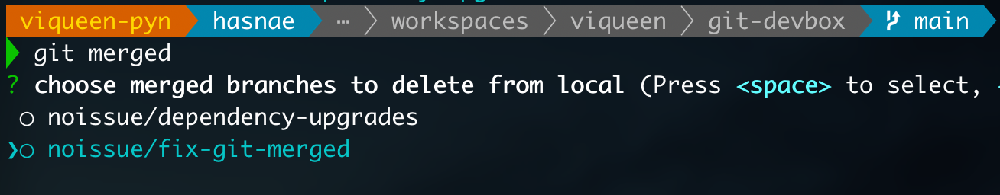

## git-workspaces

[](https://sonarcloud.io/summary/new_code?id=labset_git-workspaces)

### install it

#### from stable

- with **homebrew** (preferred)

```bash
brew tap viqueen/labset
brew install git-workspaces
```

- with **npm** (not recommended)

```bash
npm install @labset/git-workspaces -g
```

#### from source

```bash
git clone https://github.com/viqueen/git-workspaces.git
cd git-workspaces
mise install
pnpm install
pnpm build
pnpm link --global
```

### use it

#### working with branches

- list recent git branches that you've interacted with locally, select one to check it out

```bash
git recent
```



- list merged git branches that you still have locally, multi select the ones you want to delete

```bash
git merged
git merged origin/master
```



- list squashed git branches that you still have locally, multi select the ones you want to delete

```bash
git squashed
git squashed origin/master
```

- list recent branches that you've interacted with, multi select the ones you want to delete

```bash
git tidy
```

#### working with worktrees

- add a worktree for the current repo, created under the `<item>-worktrees`
  sibling folder

```bash
git work add <name>
```

- list the current repo worktrees, multi select the ones you want to remove

```bash
git work remove
```

#### setup git workspaces

- start by some configuration

```bash
git workspace config
```

it will add the following git global config entries

```text
git.workspaces.root                     # where you want all your workspaces to be
git.workspaces.default                  # your default workspace, i.e open-source vs work
```

- add a repo to your workspace

```bash
git workspace add <urlConnection>         # adds to default workspace
git workspace add <urlConnect> -w <name>  # adds to workspace with provided name
```

- view your workspace

```bash
git workspace             # describes default workspace
git workspace -w <name>   # describes workspace with provided name
```

- clone your entire workspace

```bash
git workspace clone
git workspace clone -w <name>
```

> [!NOTE]
> To run scripts or make changes across many repos, use
> [multi-gitter](https://github.com/lindell/multi-gitter) against your cloned
> workspace. The built-in `workspace-exec` command has been removed in its favour.
